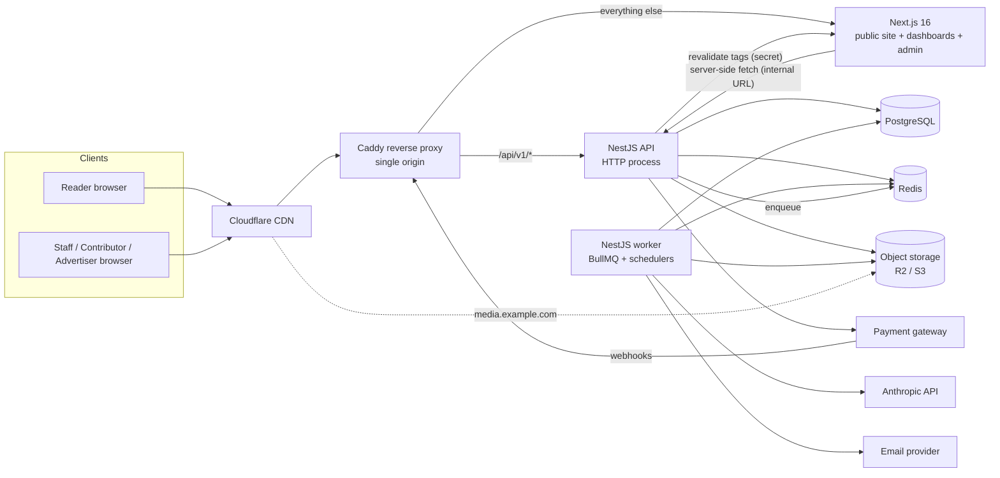
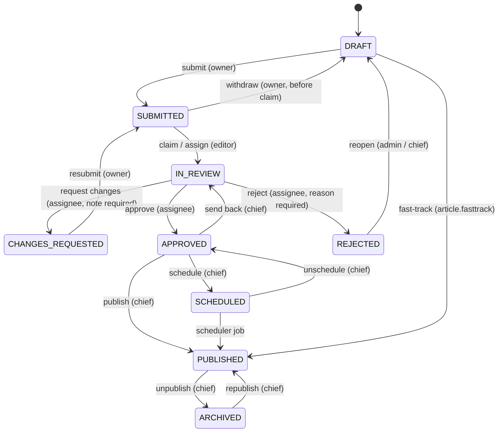
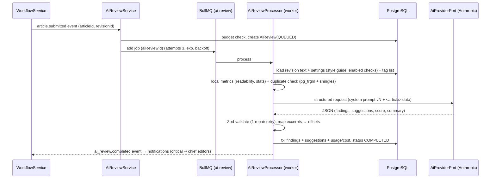
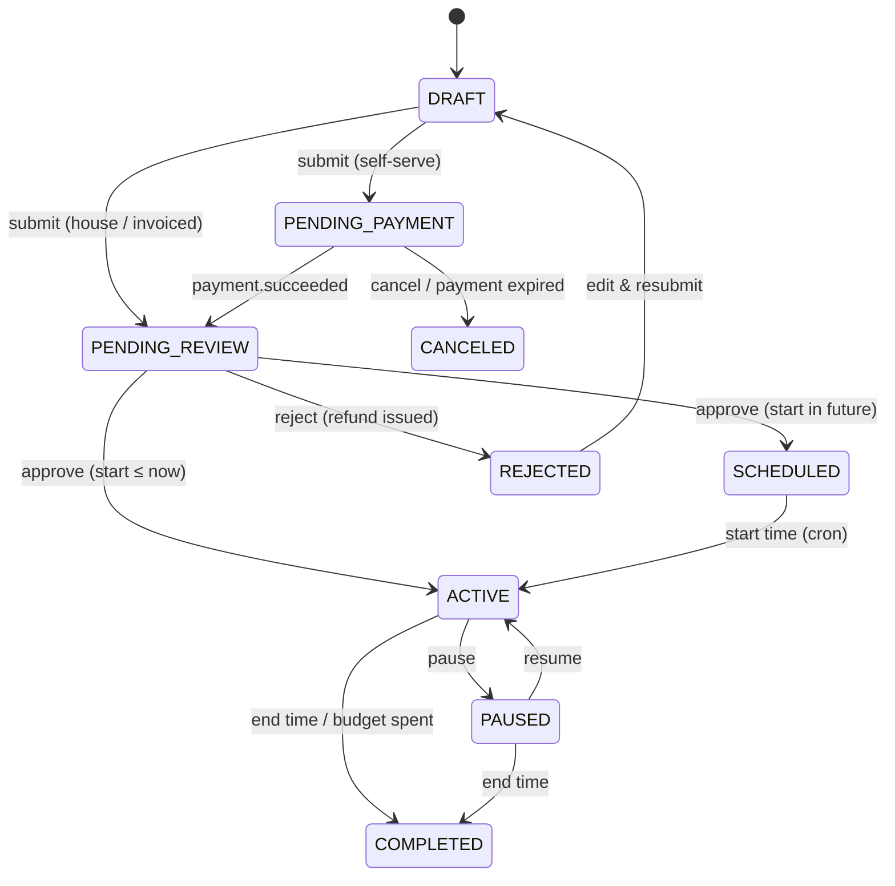

# Newsroom Platform — Architecture

> Source of truth for **how** the system is built. `docs/REQUIREMENTS.md` is the source of truth for **what**.
> Section numbers (§) are referenced from `CLAUDE.md` and `docs/PROMPTS.md` — keep them stable; append new sections at the end.

---

## §1 Overview & principles

**Style:** modular monolith. One NestJS codebase, deployed as two processes from the same image (`api` = HTTP, `worker` = BullMQ processors + schedulers), plus one Next.js app for the public site, dashboards and admin.

| # | Principle | What it means in code |
|---|-----------|----------------------|
| P1 | **Layering: Controller → Service → Repository** | Controllers: HTTP only (parse, authorize, call one service method, map response). Services: use-cases & business rules. Repositories: the only classes that touch Prisma. |
| P2 | **SOLID** | Single-purpose services; depend on **ports** (interfaces + DI tokens) for storage, mail, AI, payments; adapters are swappable. |
| P3 | **Contracts first** | Request/response shapes are Zod schemas in `packages/contracts`, shared by API (validation) and web (types + forms). |
| P4 | **Explicit state machines** | Article workflow, campaign lifecycle, subscription status change only through dedicated services with a transition table. |
| P5 | **Async by default for slow/external work** | AI review, image processing, emails, webhooks, stats flushing run in BullMQ jobs; HTTP requests stay fast. |
| P6 | **Domain events for side-effects** | Services emit events (`article.published`, `campaign.approved`…); listeners do notifications, cache revalidation, search, audit. Core logic never calls notification code directly. |
| P7 | **Consistency where money/content is at stake** | DB transactions for multi-row writes, optimistic locking on articles, idempotency keys and webhook dedupe for payments, `Decimal` for money. |
| P8 | **Secure by default** | Every endpoint is authenticated unless `@Public()`; every authenticated endpoint declares permissions; every input validated; HTML sanitised server-side. |
| P9 | **Observable** | Structured logs with request id, audit log for privileged actions, health checks, error tracking. |

---

## §2 Technology stack

Pin exact versions in `package.json` at bootstrap; versions below were current in Oct 2026.

| Layer | Choice | Notes |
|-------|--------|-------|
| Runtime | **Node.js 22 LTS** (or 24 LTS) | NestJS 12 requires Node 20.19+/22.12+/24+ |
| Package manager / monorepo | **pnpm workspaces + Turborepo** | `pnpm@10` |
| Language | **TypeScript 5.x, `strict: true`** | No `any` (lint error) |
| API framework | **NestJS 12** (CommonJS project) | Uses built-in `StandardSchemaValidationPipe` with Zod |
| Validation / contracts | **Zod 4** in `packages/contracts` | Same schemas validate API input and web forms |
| ORM / DB | **Prisma ORM 7.10.x** + **PostgreSQL 16/17** | `prisma-client` generator, `prisma.config.ts`, `@prisma/adapter-pg`. (Prisma 8 is in RC — do not adopt until stable.) |
| Cache / queues | **Redis 7** + **BullMQ** (`@nestjs/bullmq`) | Also rate-limit storage, counters, locks |
| Transactions | `nestjs-cls` + `@nestjs-cls/transactional` (Prisma adapter) | `@Transactional()` on service methods; repositories use the CLS transaction client |
| Auth | `@nestjs/jwt`, `@node-rs/argon2`, `passport-google-oauth20` (via `@nestjs/passport`), `otplib` (TOTP) | |
| Docs | `@nestjs/swagger` at `/api/docs` | Zod → JSON Schema via `z.toJSONSchema()` for request/response bodies |
| Logging | `nestjs-pino` (JSON) | request id from CLS |
| Storage | S3-compatible via `@aws-sdk/client-s3` | Prod: Cloudflare R2 / AWS S3 / DO Spaces. Local: **SeaweedFS** (MinIO's community edition is no longer maintained) |
| Images | `sharp`, `file-type` | Variants + MIME sniffing |
| Rich text | **TipTap 3** (ProseMirror JSON) | Server-side HTML via TipTap's HTML utilities + `sanitize-html` allow-list |
| AI | `@anthropic-ai/sdk` behind `AiProviderPort` | Default models from env: `claude-sonnet-5-5` (review), `claude-haiku-5-5` (fast tasks) |
| Payments | `stripe` behind `PaymentGatewayPort` | Second adapter (SSLCommerz / other) per client market |
| Email | `nodemailer` (SMTP/SES/Postmark) + Handlebars templates | Local: Mailpit |
| Web framework | **Next.js 16** (App Router, Turbopack), **React 19** | `proxy.ts` (replaces `middleware.ts` in v16) |
| UI | **Tailwind CSS 4**, **shadcn/ui**, `lucide-react`, `sonner` | Reusable form components in `components/form` |
| Client data | **TanStack Query 5**, `react-hook-form` + `@hookform/resolvers/zod` | |
| Charts | `recharts` | Dashboards/reports |
| i18n | `next-intl` | English first; structure ready for bn/ar (RTL) |
| Testing | API: Jest + Supertest; Web: Vitest + Testing Library; E2E: **Playwright** | |
| Quality | ESLint (flat config), Prettier, Husky + lint-staged, commitlint (Conventional Commits) | |
| Observability | Sentry (API + web), `@nestjs/terminus` health, optional OpenTelemetry | |
| Infra | Docker, Docker Compose, Caddy (TLS + reverse proxy), GitHub Actions, Cloudflare CDN | |

---

## §3 System context



**Single origin:** the browser only talks to `https://example.com`. Caddy routes `/api/v1/*` to NestJS and everything else to Next.js. Benefits: first-party cookies, no CORS, simple CSRF story. In local dev, `next.config.ts` rewrites `/api/v1/:path*` → `http://localhost:4000/api/v1/:path*` to mimic this.

---

## §4 Repository layout

```
newsroom/
├── CLAUDE.md                     # rules for Claude Code (root)
├── docs/                         # REQUIREMENTS, ARCHITECTURE, API_SPEC, PROMPTS, PROGRESS, DECISIONS, OPEN_QUESTIONS
├── .claude/                      # Claude Code commands & settings
├── apps/
│   ├── api/                      # NestJS 12  (has its own CLAUDE.md)
│   └── web/                      # Next.js 16 (has its own CLAUDE.md)
├── packages/
│   ├── contracts/                # Zod schemas, enums, permission keys, notification types (built with tsup → cjs + esm + d.ts)
│   ├── eslint-config/            # shared flat ESLint config
│   └── tsconfig/                 # shared tsconfig bases
├── docker/                       # Dockerfiles, Caddyfile, seaweedfs config
├── docker-compose.yml            # local infrastructure (postgres, redis, seaweedfs, mailpit)
├── turbo.json
├── pnpm-workspace.yaml
├── package.json
└── .env.example
```

### §4.1 API layout (`apps/api`)

```
apps/api/
├── prisma/
│   ├── schema.prisma
│   ├── migrations/
│   ├── sql/001_extensions_and_search.sql   # pasted into the init migration
│   └── seed/ (index.ts, roles.seed.ts, permissions.seed.ts, categories.seed.ts, placements.seed.ts, plans.seed.ts, settings.seed.ts, demo.seed.ts)
├── prisma.config.ts
├── src/
│   ├── main.ts                     # HTTP bootstrap (rawBody: true for webhooks)
│   ├── worker.ts                   # worker bootstrap: same modules, no HTTP listener, registers processors + cron
│   ├── app.module.ts
│   ├── config/                     # env.schema.ts (zod), app.config.ts, typed namespaces
│   ├── common/
│   │   ├── decorators/             # @Public @RequirePermissions @CurrentUser @Audit @Idempotent @SkipEnvelope
│   │   ├── guards/                 # JwtAuthGuard (global) PermissionsGuard (global) CsrfGuard (global) ThrottlerGuard
│   │   ├── interceptors/           # ResponseEnvelopeInterceptor AuditInterceptor
│   │   ├── filters/                # ProblemDetailsFilter (all errors → RFC 9457)
│   │   ├── errors/                 # DomainError + subclasses + ErrorCode enum
│   │   ├── pagination/             # offset + cursor helpers
│   │   └── utils/                  # slug, crypto, dates, html
│   ├── infrastructure/             # adapters to the outside world (no business rules)
│   │   ├── database/               # PrismaModule, PrismaService (adapter-pg), transactional setup
│   │   ├── redis/                  # RedisModule (ioredis), CacheService, LockService
│   │   ├── queue/                  # BullMQ registration, QUEUES constants
│   │   ├── storage/                # STORAGE_PORT + S3StorageAdapter
│   │   ├── mail/                   # MAIL_PORT + SmtpMailAdapter + templates/*.hbs
│   │   ├── ai/                     # AI_PROVIDER_PORT + AnthropicAdapter + prompts/ + pricing table
│   │   ├── payments/               # PAYMENT_GATEWAYS (map provider → adapter) + StripeAdapter (+ SslCommerzAdapter)
│   │   ├── crypto/                 # EncryptionService (AES-256-GCM), HmacService
│   │   └── web-revalidation/       # WebRevalidationService → Next.js /api/revalidate
│   ├── modules/                    # business modules — see §5.2
│   └── generated/prisma/           # Prisma client output (git-ignored)
└── test/                           # e2e specs, factories, helpers (test DB reset, auth helpers)
```

### §4.2 Module internal layout (every business module follows this)

```
modules/articles/
├── articles.module.ts
├── controllers/          articles.controller.ts            # thin; one service call per handler
├── services/             articles.service.ts               # use-cases
│                         article-content.service.ts        # JSON → sanitised HTML, plain text, word count, reading time
│                         slug.service.ts
├── repositories/         articles.repository.ts            # Prisma access only; soft-delete filtering; select shapes
├── policies/             article.policy.ts                 # canView/canEdit/canDelete(user, article) — pure functions
├── mappers/              article.mapper.ts                 # entity → response DTO (never return Prisma rows directly)
├── events/               article.events.ts                 # event classes + names
├── listeners/            *.listener.ts                     # react to other modules' events
├── processors/           *.processor.ts                    # BullMQ processors (worker process only)
└── __tests__/            *.spec.ts                         # unit tests (services, policies)
```

---

## §5 Backend architecture

### §5.1 Request lifecycle

```
HTTP → helmet/cookie-parser → CLS (requestId, user, ip, ua) → ThrottlerGuard → JwtAuthGuard (skip if @Public)
     → CsrfGuard (mutations with cookie auth) → PermissionsGuard (@RequirePermissions)
     → StandardSchemaValidationPipe (@Body/@Query/@Param({ schema }))
     → Controller → Service (@Transactional where needed) → Repository → Prisma
     → ResponseEnvelopeInterceptor ({ data, meta }) / AuditInterceptor (@Audit)
Errors → ProblemDetailsFilter (application/problem+json)
```

### §5.2 Module catalogue

| Module (folder) | Req. ID | Owns models | Depends on | Emits events |
|-----------------|---------|-------------|------------|--------------|
| `auth` | M01 | RefreshToken, VerificationToken, OAuthAccount | users, rbac, mail | `user.registered`, `user.password_reset` |
| `users` | M02 | User, AuthorProfile, ContributorApplication | rbac, media | `user.suspended`, `contributor.approved` |
| `rbac` | M02 | Role, Permission, RolePermission, UserRole | — | `role.changed` |
| `taxonomy` | M03 | Category, Tag, ArticleTag (tag side) | — | `category.updated` |
| `media` | M04 | MediaAsset | storage, queue | `media.ready` |
| `articles` | M05 | Article, ArticleRevision, ArticleCoAuthor, ArticleSlugRedirect, ArticleCorrection | taxonomy, media | `article.updated` |
| `workflow` | M06 | WorkflowTransition, EditorialAssignment, EditorialNote | articles, settings | `article.submitted`, `article.changes_requested`, `article.approved`, `article.rejected`, `article.scheduled`, `article.published`, `article.unpublished`, `assignment.created` |
| `ai-review` | M07 | AiReview, AiReviewFinding | articles, ai, settings | `ai_review.completed`, `ai_review.failed` |
| `public-content` | M08 | (read-only views) | articles, taxonomy, settings, billing (entitlements) | — |
| `engagement` | M09 | Comment, CommentLike, CommentReport, ArticleReaction, Bookmark, AuthorFollow, CategoryFollow, NewsletterSubscriber | articles | `comment.created`, `comment.replied`, `comment.reported` |
| `search` | M10 | (tsvector on Article) | articles | — |
| `ads` | M11 | Advertiser, AdPlacement, AdCampaign*, AdCreative, AdDailyStat | media, billing, redis | `campaign.submitted`, `campaign.approved`, `campaign.rejected`, `campaign.completed`, `campaign.low_budget` |
| `billing` | M12 | Plan, Subscription, Payment, Refund, Invoice, InvoiceItem, WebhookEvent | payments port | `payment.succeeded`, `payment.failed`, `subscription.activated`, `subscription.canceled`, `refund.processed` |
| `payouts` | M13 | Payout, PayoutItem | articles | `payout.paid` |
| `notifications` | M14 | Notification, NotificationPreference, EmailLog | mail, queue | — (listens to almost everything) |
| `dashboards` | M15 | (read models) | most modules' repositories via services | — |
| `site` | M16 | SiteSetting, Page, Menu | web-revalidation | `settings.updated`, `page.published` |
| `analytics` | M17 | ArticleDailyStat | redis | — |
| `audit` | M18 | AuditLog | — | — (listens to `*`) |
| `health` | — | — | database, redis | — |

**Rule:** a module may import another module's **service** (exported from its module) but never its repository. Cyclic needs are solved with events.

### §5.3 Cross-cutting building blocks

- **Config:** `src/config/env.schema.ts` (Zod) validated at boot via `@nestjs/config` (`validationSchema` accepts Standard Schema in v12). Access through typed `ConfigService` getters only — never `process.env` outside config.
- **Validation:** `@Body({ schema: CreateArticleSchema }) body: CreateArticleInput` using NestJS 12 `StandardSchemaValidationPipe`. Schemas imported from `@newsroom/contracts`. Unknown keys stripped (`z.object` default) — use `.strict()` for admin/settings payloads.
- **Response envelope:** success → `{ "data": ..., "meta": { ... } }`. `@SkipEnvelope()` for redirects, files, webhooks, beacons.
- **Errors:** throw `DomainError` subclasses (`NotFoundError`, `ForbiddenError`, `ConflictError`, `ValidationError`, `InvalidStateTransitionError`, `PaymentRequiredError`, `RateLimitedError`) carrying an `ErrorCode`. The filter maps to RFC 9457:
  ```json
  { "type": "https://example.com/errors/ARTICLE_VERSION_CONFLICT", "title": "Conflict", "status": 409,
    "detail": "Article was modified by someone else", "code": "ARTICLE_VERSION_CONFLICT",
    "errors": [{ "path": "version", "message": "expected 7, got 6" }], "requestId": "01J..." }
  ```
- **Transactions:** `@Transactional()` from `@nestjs-cls/transactional` on service methods that write more than one row; repositories always use `this.txHost.tx` (falls back to the plain client outside a transaction). Verify adapter compatibility with Prisma 7 at bootstrap; if incompatible, implement the same API with `AsyncLocalStorage` + `prisma.$transaction`.
- **Soft delete:** repositories add `deletedAt: null` to every read by default; `withDeleted` option for admins.
- **Audit:** `@Audit('article.publish', { entity: 'Article', idParam: 'id' })` on controller methods, or `AuditService.record()` inside services for before/after diffs. Append-only.
- **Idempotency:** `@Idempotent()` on payment-creating endpoints reads `Idempotency-Key` header; stores response in Redis 24 h.
- **Events:** `@nestjs/event-emitter` for in-process events; listeners that do slow work enqueue a BullMQ job instead of doing it inline.
- **Locks:** `LockService` (Redis `SET NX PX`) for cron jobs so that multiple worker replicas don't double-run.

---

## §6 Authentication

| Item | Design |
|------|--------|
| Password hashing | argon2id (`@node-rs/argon2`), params m=19 MiB, t=2, p=1 |
| Access token | JWT (HS256, `JWT_ACCESS_SECRET`), 15 min, claims: `sub` (user id), `sid` (refresh token family id), no PII. Permissions are NOT in the token — they are read from the Redis permission cache so role changes apply immediately |
| Refresh token | 256-bit random opaque token, stored as sha256 in `RefreshToken`, 30-day expiry, rotated on every use |
| Reuse detection | presenting a revoked refresh token ⇒ revoke every token in the `familyId`, audit `auth.refresh_reuse_detected` |
| Cookies | `nr_at` (access; `Path=/`), `nr_rt` (refresh; `Path=/api/v1/auth`), both `HttpOnly; Secure; SameSite=Lax`; `nr_csrf` (readable) |
| CSRF | double-submit: `CsrfGuard` requires header `X-CSRF-Token` == cookie `nr_csrf` on POST/PUT/PATCH/DELETE when the request is cookie-authenticated. Webhooks/beacons are `@Public()` + `@SkipCsrf()` |
| Email verification | token (sha256 stored) 24 h; unverified users can log in but cannot submit/comment/pay |
| Password reset | token 1 h; on success revoke all refresh tokens |
| OAuth | Google: `/auth/google` → callback → link by verified email or create user (status ACTIVE, emailVerifiedAt set) |
| 2FA | TOTP (otplib), secret encrypted with `EncryptionService`; login returns `{ requires2fa: true, challengeToken }` (5 min) → `/auth/2fa/verify`; 10 recovery codes (hashed). Enforced for roles listed in setting `security.require2faRoles` |
| Rate limits | login 5/min/IP + 10/hour/account; register 3/hour/IP; forgot-password 3/hour/email; refresh 30/min/IP |
| Permission cache | effective permissions per user cached in Redis (`perm:{userId}`), invalidated on role change (`role.changed` event) |

**Web side:** `apps/web/src/proxy.ts` (Node runtime) runs on dashboard/admin routes: if `nr_at` is missing/expired and `nr_rt` exists, it calls `POST /api/v1/auth/refresh` server-to-server, forwards the new `Set-Cookie` headers on the response, then continues. If refresh fails → redirect to `/login?next=…`. Layouts additionally call `GET /api/v1/auth/me` (cached per request) for role/permission checks — the proxy is a convenience, **the API is the authority**.

---

## §7 Authorization

- **RBAC:** `@RequirePermissions('article.publish')` (all-of) or `@RequireAnyPermission(...)`. `PermissionsGuard` loads effective permissions from cache.
- **Ownership/state policies:** pure functions in `policies/` called by services, e.g. `ArticlePolicy.canEdit(user, article)`:
  - author/co-author may edit when status ∈ {DRAFT, CHANGES_REQUESTED} and has `article.update.own`
  - assigned editor may edit when status ∈ {IN_REVIEW, APPROVED} and has `article.review`
  - `article.update.any` may edit any non-deleted article (published edits create a CORRECTION revision)
- **Data scoping:** list endpoints apply scope in the repository query (e.g. advertisers only see their own campaigns) — never filter after fetching.

### §7.1 Default role → permission matrix (seed)

| Permission | READER | CONTRIB. | AUTHOR | EDITOR | CHIEF | MOD | ADVERT. | AD_MGR | ADMIN | SUPER |
|-----------|:--:|:--:|:--:|:--:|:--:|:--:|:--:|:--:|:--:|:--:|
| comment.create, report.create, subscription.self | ✓ | ✓ | ✓ | ✓ | ✓ | ✓ | ✓ | ✓ | ✓ | ✓ |
| article.create, article.update.own, article.delete.own, article.submit, media.upload, ai.review.run.own, payout.view.own | | ✓ | ✓ | ✓ | ✓ | | | | | ✓ |
| tag.create | | | ✓ | ✓ | ✓ | | | | ✓ | ✓ |
| article.review, article.update.any, article.approve, article.reject, ai.review.run.any, dashboard.editorial | | | | ✓ | ✓ | | | | | ✓ |
| article.assign, article.publish, article.schedule, article.unpublish, article.feature, article.fasttrack | | | | | ✓ | | | | | ✓ |
| comment.moderate | | | | ✓ | ✓ | ✓ | | | ✓ | ✓ |
| category.manage, tag.manage, media.manage.any | | | | | ✓ | | | | ✓ | ✓ |
| advertiser.self, ad.campaign.manage.own | | | | | | | ✓ | | | ✓ |
| ad.campaign.review, ad.campaign.manage.any, ad.placement.manage, ad.report.view.any | | | | | | | | ✓ | ✓ | ✓ |
| payment.view.any, invoice.view.any, plan.manage, payment.refund, payout.manage | | | | | | | | | ✓ | ✓ |
| user.view, user.manage, settings.manage, page.manage, menu.manage, report.view, audit.view, dashboard.admin | | | | | | | | | ✓ | ✓ |
| ai.settings.manage, role.manage, article.delete.any | | | | | | | | | | ✓ |

`SUPER_ADMIN` receives **all** permissions (seed assigns every key). `ADMIN` deliberately lacks editorial publishing power unless also given `CHIEF_EDITOR`.

---

## §8 Editorial workflow (state machine)



### §8.1 Transition table (implemented as data in `workflow/workflow.transitions.ts`)

| Action | From | To | Permission | Actor rule | Guards / side-effects |
|--------|------|----|-----------|------------|------------------------|
| SUBMIT | DRAFT | SUBMITTED | article.submit | owner or co-author | completeness check (§8.2); email verified; create revision `SUBMIT`; set `submittedAt`; enqueue AI review (AUTO_ON_SUBMIT); release edit lock |
| WITHDRAW | SUBMITTED | DRAFT | article.submit | owner | only if no ACTIVE assignment |
| CLAIM | SUBMITTED | IN_REVIEW | article.review | self | create assignment (assignedById null) |
| ASSIGN | SUBMITTED, IN_REVIEW | IN_REVIEW | article.assign | any | previous ACTIVE assignment → REASSIGNED |
| REQUEST_CHANGES | IN_REVIEW | CHANGES_REQUESTED | article.review | active assignee or `article.assign` | note required (≥ 10 chars) → also stored as `EditorialNote` (AUTHOR visibility) |
| RESUBMIT | CHANGES_REQUESTED | SUBMITTED | article.submit | owner | content must differ from last SUBMIT revision; revision `RESUBMIT`; AI review enqueued; previous assignee re-assigned automatically (status IN_REVIEW directly if assignee still active — setting `workflow.autoReassignOnResubmit`) |
| APPROVE | IN_REVIEW | APPROVED | article.approve | active assignee or `article.assign` | if latest AI review has OPEN CRITICAL findings → body must include `acknowledgeCriticalFindings: true` (stored in transition metadata); revision `APPROVE`; complete assignment. If `workflow.requireChiefApproval = false` **and** actor has `article.publish`, UI offers "Approve & publish" (two transitions in one transaction) |
| REJECT | IN_REVIEW | REJECTED | article.reject | active assignee or `article.assign` | reason required; set `rejectedAt`, `rejectionReason` |
| SEND_BACK | APPROVED | IN_REVIEW | article.review | any with permission | note required |
| SCHEDULE | APPROVED | SCHEDULED | article.schedule | any | `scheduledAt` ≥ now + 2 min; enqueue delayed job `workflow.publish-scheduled` with jobId = articleId |
| UNSCHEDULE | SCHEDULED | APPROVED | article.schedule | any | remove delayed job |
| PUBLISH | APPROVED | PUBLISHED | article.publish | any | revision `PUBLISH`; set `publishedAt` (first time) and `lastPublishedAt`; emit `article.published` |
| AUTO_PUBLISH | SCHEDULED | PUBLISHED | system | scheduler | same as PUBLISH; actorId null |
| FASTTRACK | DRAFT | PUBLISHED | article.fasttrack | owner | completeness check; `needsPostPublishReview = true`; notify chief editors |
| UNPUBLISH | PUBLISHED | ARCHIVED | article.unpublish | any | reason required; emit `article.unpublished` (revalidate, remove from sitemap) |
| REPUBLISH | ARCHIVED | PUBLISHED | article.publish | any | `lastPublishedAt = now` |
| REOPEN | REJECTED | DRAFT | article.assign | any | note required |

### §8.2 Submission completeness check (configurable in settings `workflow.*`)

title (10–250 chars) · excerpt (50–500) · primary category · featured image **READY with alt text** · word count ≥ `workflow.minWords` (default 300) · no empty headings · all images in body have alt text.

### §8.3 Implementation rules

- `WorkflowService.transition(articleId, action, actor, payload)` is the **only** code path that changes `Article.status`. `ArticlesRepository.update()` rejects `status` in its input type.
- Runs inside `@Transactional()`: lock row with `SELECT … FOR UPDATE` (raw query in repository), check transition table, check policy, check `version` if supplied, apply, insert `WorkflowTransition`, create revision when required, then emit events **after commit** (`@nestjs-cls/transactional` hooks or emit at end of service method).
- Scheduler safety net: cron every minute publishes any `SCHEDULED` article with `scheduledAt <= now()` (covers lost delayed jobs), guarded by `LockService`.
- Every transition writes an `AuditLog` row too (`article.<action>`).

### §8.4 Editing rules while in workflow

| Status | Who can edit content | Notes |
|--------|---------------------|-------|
| DRAFT, CHANGES_REQUESTED | owner/co-authors | autosave with `version` |
| SUBMITTED | nobody (withdraw first) | |
| IN_REVIEW, APPROVED | active assignee / `article.update.any` | edits create `MANUAL` revisions on demand; author sees diff |
| SCHEDULED | `article.update.any` | changing content keeps schedule |
| PUBLISHED | `article.update.any` | save = CORRECTION revision + optional public `ArticleCorrection`; triggers revalidation |
| ARCHIVED, REJECTED | nobody | |

---

## §9 Content pipeline

1. Editor produces ProseMirror JSON (TipTap 3). Allowed node/mark types are listed in `packages/contracts/src/articles/editor-schema.ts` (single list used by web editor config and API sanitiser).
2. `PATCH /articles/:id` with `{ content, version, ... }` → `ArticleContentService.process(content)`:
   - validate JSON against the allowed node types (reject unknown nodes)
   - render HTML server-side with TipTap's HTML utilities using the **same extension list** as the editor
   - sanitise with `sanitize-html` allow-list (tags, attributes, `rel="noopener nofollow ugc"` on external links, iframes only from embed allow-list: youtube.com, youtube-nocookie.com, player.vimeo.com, platform.twitter.com, facebook.com, instagram.com, w.soundcloud.com)
   - extract `plainText`, compute `wordCount`, `readingTimeMinutes = ceil(words / 220)`
   - collect referenced media ids (for "used in" info and to block deletion of used media)
3. Optimistic locking: repository `updateMany({ where: { id, version }, data: { ..., version: { increment: 1 } } })`; 0 rows ⇒ `409 ARTICLE_VERSION_CONFLICT` with the current version and `updatedBy` for the UI.
4. **Slug:** generated from title (`slugify`, lower-case, max 280, transliteration for non-Latin falls back to short id suffix). Unique with `-2`, `-3` suffixes. Editable until first publish; after publish a change inserts `ArticleSlugRedirect(oldSlug)`.
5. **Edit lock:** `POST /articles/:id/lock` (acquire/heartbeat every 60 s) → sets `lockedById/lockedAt` if free or stale (> 5 min). `DELETE` releases. Take-over requires `article.update.any` and is audited. Locks are advisory; `version` is the real guard.
6. **Preview:** `POST /articles/:id/preview-token` → signed token (HMAC, 1 h) → web `/preview/[token]` renders with `noindex`.

---

## §10 AI-assisted review pipeline (M07)



**Ports & adapters**

```ts
// infrastructure/ai/ai-provider.port.ts
export interface AiProviderPort {
  readonly name: 'anthropic' | 'openai';
  generateStructured<T>(req: {
    model: string; system: string; userContent: string;
    schema: z.ZodType<T>; maxOutputTokens: number; temperature?: number;
  }): Promise<{ data: T; usage: { inputTokens: number; outputTokens: number }; latencyMs: number; model: string }>;
}
export const AI_PROVIDER = Symbol('AI_PROVIDER');
```

- Anthropic adapter forces JSON via a single tool whose `input_schema` is `z.toJSONSchema(schema)` (or the SDK's structured-output feature if available in the installed version), then validates with Zod.
- **Prompts are versioned code**: `infrastructure/ai/prompts/review.v1.ts` exports `{ version: 'review.v1', system, buildUserContent(article, settings), outputSchema }`. Changing a prompt = new version file; `AiReview.promptVersion` records which was used.
- **Prompt-injection hygiene:** article text is wrapped in `<article>` tags and the system prompt states it is untrusted data to be evaluated, never instructions. The model's output can only produce findings/suggestions — it has no tools that act.
- **Output schema (summary):** `{ overallScore: 0-100, summary: string, findings: [{ category, severity, message, suggestion?, excerpt? }] (max 40), suggestions: { headlines: string[3..5], seoTitle ≤ 60, metaDescription ≤ 160, excerpt ≤ 300, tags: string[≤8] } }`.
- **Long articles:** > 12k words → split by top-level headings into chunks ≤ 6k words; run the findings pass per chunk with the review model, then one summary/suggestions pass on title + excerpt + section headings. Merge and de-duplicate findings before saving.
- **Cost control:** pricing table per model in `infrastructure/ai/pricing.ts` (USD per million input/output tokens, configurable via env override). Month-to-date spend = `SUM(costUsd)`; if ≥ `ai.monthlyBudgetUsd` → manual runs return `402 AI_BUDGET_EXCEEDED`, auto runs are skipped with a notice. Author self-checks limited to `ai.authorRunsPerDay` (default 5).
- **Advisory only:** nothing in this module changes article status or content. "Apply suggestion" buttons in the UI call normal article update endpoints as the human user.
- **Duplicate check:** candidates via `title % $1` (pg_trgm) + FTS on top keywords (last 2 years, PUBLISHED), then 5-gram shingle Jaccard on `plainText` for top 20; matches ≥ 0.35 stored in `duplicateMatches` and produce a `DUPLICATE` finding.

---

## §11 Media pipeline (M04)

1. `POST /media/uploads` `{ fileName, mimeType, sizeBytes, kind }` → validate allow-list & size → `MediaAsset(PENDING)` with key `uploads/{yyyy}/{mm}/{uuid}.{ext}` → presigned `PUT` URL (5 min, content-type + content-length bound).
2. Browser uploads directly to storage (progress bar).
3. `POST /media/:id/complete` → `HEAD` object (size must match) → status `PROCESSING` → enqueue `media.process`.
4. Worker: download → sniff with `file-type` (mismatch ⇒ delete object, `FAILED`) → `sharp().rotate()` (applies EXIF orientation, strips metadata) → WebP variants at widths 320/640/1024/1600 + 200×200 thumb (never upscale) → store `variants`, `width`, `height`, `checksum` → `READY` → `media.ready` event (UI polls or receives notification).
5. Public URL = `MEDIA_PUBLIC_BASE_URL + key` (CDN in front of the bucket). Web uses a custom `next/image` loader that picks the closest variant.
6. Deletion: soft delete; blocked if referenced by a published article or active creative; purge job removes objects for assets soft-deleted > 30 days.

---

## §12 Public site rendering, caching & SEO (M08)

### §12.1 Rendering strategy

| Route | Rendering | Cache tags |
|-------|-----------|-----------|
| `/` | static + on-demand revalidation (fallback `revalidate` 300 s) | `home`, `articles` |
| `/category/[slug]` | static params for active categories, ISR | `category:{slug}`, `articles` |
| `/article/[slug]` | static on first request, ISR | `article:{slug}` |
| `/author/[username]`, `/tag/[slug]` | ISR | `author:{username}`, `tag:{slug}` |
| `/page/[slug]` | ISR | `page:{slug}` |
| `/search` | dynamic | — |
| `/dashboard/**`, `/admin/**` | dynamic, client data via TanStack Query | — |

- Server-side data fetching uses `lib/api/server.ts` (`fetch` to `API_INTERNAL_URL`, forwards cookies only for personalised routes) with Next cache tags. If the project enables Next 16 Cache Components (`cacheComponents: true`), use `'use cache'` + `cacheTag()` + `cacheLife()` instead — pick one approach at bootstrap and record it in `docs/DECISIONS.md`.
- **On-demand revalidation:** listeners on `article.published|updated|unpublished`, `category.updated`, `page.published`, `settings.updated` call `WebRevalidationService.revalidate(tags)` → `POST {WEB_INTERNAL_URL}/api/revalidate` with header `x-revalidate-secret`. The route handler calls `revalidateTag(tag, 'max')` (Next 16 signature — confirm against installed version).
- **Paywall:** article API returns `{ access: 'full' | 'teaser', requires: 'login' | 'subscription' | null }`. The cached page always renders the teaser for PREMIUM/MEMBERS articles; a client component (`<ArticleAccessGate>`) fetches `/public/articles/:id/body` with credentials when the user is entitled. Full premium HTML is never in the static cache.
- **Views:** `<ViewBeacon articleId>` sends `navigator.sendBeacon('/api/v1/public/articles/:id/view')` after 5 s visible. API: bot filter (`isbot`), visitor hash = sha256(ip + UA + daily salt), Redis `SET NX EX 1800` dedupe, `INCR views:{date}:{id}`, `PFADD uv:{date}:{id}`. Hourly job flushes to `ArticleDailyStat` and `Article.viewCount`; "most read" = Redis sorted set for 24 h/7 d.

### §12.2 SEO checklist

- `generateMetadata` on every public route: title template `%s | {siteName}`, description, canonical, `openGraph` (article: `publishedTime`, `modifiedTime`, `authors`, `section`, `tags`), `twitter` card, `robots` (noindex for search, preview, paginated > 1 optional).
- JSON-LD: `NewsArticle` (headline, image[1x1, 4x3, 16x9 variants], datePublished, dateModified, author[Person url], publisher Organization logo, isAccessibleForFree + `hasPart` for paywalled), `BreadcrumbList`, `WebSite` + `SearchAction` on home, `Organization`.
- `app/sitemap.ts` → sitemap index; route handlers: `/sitemaps/articles/[page].xml` (≤ 10 000 urls each), `/sitemaps/categories.xml`, `/sitemaps/authors.xml`, `/news-sitemap.xml` (Google News, last 48 h, max 1 000), `/feed.xml` and `/category/[slug]/feed.xml` (RSS 2.0), `app/robots.ts`.
- Slug redirects: `/article/[slug]` page checks `ArticleSlugRedirect` (API returns `{ redirectTo }`) → `permanentRedirect()`.

---

## §13 Search (M10)

- PostgreSQL FTS on `articles."searchVector"` (trigger-maintained, weights A: title, B: subtitle/excerpt, C: body; `simple` config + `unaccent` for language neutrality). GIN index declared in Prisma schema.
- `SearchRepository` uses `$queryRaw` with tagged-template parameters (never string concatenation): `websearch_to_tsquery`, rank `ts_rank_cd` × recency decay, filters, pagination; `ts_headline` for snippets.
- Typeahead: `title % :q` (pg_trgm) ordered by similarity, limit 8, cached 60 s in Redis.
- `SearchPort` interface allows swapping to Meilisearch later (listener on article events would index documents).

---

## §14 Advertising (M11)

### §14.1 Campaign lifecycle



Creatives are reviewed individually; a campaign is servable only with ≥ 1 APPROVED creative. Editing an approved creative resets it to PENDING_REVIEW. All transitions go through `CampaignLifecycleService` (same pattern as §8.3).

### §14.2 Serving (`GET /api/v1/p/serve?placement=…&category=…&lang=…`)

Paths use `/p/` (not `/ads/`) to reduce false positives from content blockers on first-party placements.

1. Candidate set per placement cached in Redis (`ads:cand:{placementKey}`, rebuilt on campaign/creative change events and every 60 s): campaigns `ACTIVE`, now ∈ [startAt, endAt], `spentAmount < budgetTotal`, today's spend < `budgetDaily`, with approved creatives.
2. Filter targeting: categories (empty = run-of-site), device (from UA), language.
3. Frequency cap: Redis `fcap:{yyyymmdd}:{campaignId}:{visitorId}` where `visitorId` is a random first-party cookie `nr_vid` (set by web, 1 year).
4. Choose highest priority tier with candidates (house ads are priority 0 = filler); weighted random by creative `weight`; at most `placement.maxRotating` campaigns considered per tier.
5. Response: `{ creative: {type, headline, body, imageUrl, html?, altText}, impressionToken, clickUrl }`. Tokens = base64url(payload) + HMAC (`ADS_SIGNING_SECRET`), payload `{cr, pl, cp, iat}`; valid 30 min.
6. No fill → `204`.

### §14.3 Tracking & spend

- Viewable impression: `<AdSlot>` fires `POST /p/i { token }` when ≥ 50% visible for ≥ 1 s (IntersectionObserver). API verifies HMAC + age, dedupes token (`SET NX EX 3600`), `HINCRBY adstat:{date}:{creativeId}:{placementId} imp 1`, increments frequency counter.
- Click: `GET /p/c/{token}` → verify → dedupe per token → `HINCRBY … clk 1` → `302` to `targetUrl` (validated `https` URL; UTM appended if absent).
- Bots excluded (`isbot`), staff previews excluded (`?preview=1` with staff session).
- **Flush job (every 5 min, locked):** atomically read-and-delete counters (Lua), upsert-increment `AdDailyStat`, compute spend: CPM = imp/1000 × rate, CPC = clk × rate; FLAT charged by a daily job at 00:05 site time (rate per active day). Update `AdCampaign.spentAmount` in the same transaction; if ≥ budget → COMPLETED (+ event); if remaining < 10% → `campaign.low_budget` once.
- HTML creatives are rendered only inside `<iframe sandbox="allow-scripts allow-popups allow-popups-to-escape-sandbox" srcdoc=…>` with no same-origin access.

---

## §15 Payments, subscriptions & billing (M12)

```ts
// infrastructure/payments/payment-gateway.port.ts
export interface PaymentGatewayPort {
  readonly provider: PaymentProvider;
  createOneOffCheckout(i: { paymentId: string; amount: Decimal; currency: string; description: string;
    customerEmail: string; successUrl: string; cancelUrl: string; metadata: Record<string, string> }): Promise<{ checkoutId: string; redirectUrl: string }>;
  createSubscriptionCheckout(i: { userId: string; plan: Plan; customerEmail: string; successUrl: string; cancelUrl: string }): Promise<{ checkoutId: string; redirectUrl: string }>;
  cancelSubscription(providerSubscriptionId: string, atPeriodEnd: boolean): Promise<void>;
  refund(i: { providerPaymentId: string; amount: Decimal; reason?: string }): Promise<{ providerRefundId: string; status: RefundStatus }>;
  parseWebhook(rawBody: Buffer, headers: Record<string, string>): Promise<NormalizedPaymentEvent>; // verifies signature, throws on invalid
  customerPortalUrl?(providerCustomerId: string, returnUrl: string): Promise<string>;
}
// NormalizedPaymentEvent.type: 'checkout.completed' | 'payment.succeeded' | 'payment.failed' |
//   'subscription.created' | 'subscription.updated' | 'subscription.canceled' | 'invoice.paid' | 'refund.updated'
```

- `PAYMENT_GATEWAYS` provider map; active provider(s) from settings `billing.providers`. Adding a gateway = new adapter + mapping test fixtures; no changes in `billing` services.
- **Checkout flow (ad campaign):** `POST /ads/campaigns/:id/checkout` (`Idempotency-Key`) → `Payment(PENDING, purpose AD_CAMPAIGN, amount = budgetTotal)` → adapter → `{ redirectUrl }`. Success page **polls** `GET /billing/payments/:id` — the redirect is never trusted.
- **Webhooks:** `POST /api/v1/billing/webhooks/:provider` (`@Public`, raw body, no CSRF, no envelope) → `parseWebhook` → insert `WebhookEvent` (unique `(provider, eventId)`; duplicate ⇒ 200 immediately) → enqueue `billing.process-webhook` → handler in `@Transactional()` updates Payment/Subscription/Invoice and emits events (`payment.succeeded` → ads moves campaign to PENDING_REVIEW; `subscription.activated` → entitlement cache cleared).
- **Entitlements:** `EntitlementService.hasPremium(userId)` = subscription ACTIVE/TRIALING, or PAST_DUE within `billing.graceDays`, or CANCELED with `currentPeriodEnd > now`. Cached in Redis 5 min, busted on subscription events.
- **Invoices:** created on successful payment; number from `invoice_number_seq` → `INV-{yyyy}-{000000}`; PDF rendered by a job (`pdfkit`), stored in bucket, downloaded via short-lived signed URL.
- **Refunds:** `POST /admin/billing/payments/:id/refunds` (`payment.refund`) → adapter → `Refund(PENDING)`; webhook `refund.updated` finalises; campaign budget/spent reconciled; audit logged.
- **Gateways without native subscriptions (e.g. SSLCommerz):** subscription = prepaid period purchase; renewal reminder emails 7/3/1 days before `currentPeriodEnd`; status → EXPIRED by daily job.
- PCI: card data never touches our servers (hosted checkout pages only).

---

## §16 Notifications & email (M14)

- Notification types are a catalogue in `packages/contracts/src/notifications.ts`: `{ type, defaultChannels, mandatory, titleTemplate, link(data) }`.
- `NotificationService.notify(userIds, type, data)` → resolves preferences → bulk insert `Notification` rows (IN_APP) → enqueue `mail.send` jobs (EMAIL) → `EmailLog(QUEUED)`.
- Mail worker renders Handlebars template (`infrastructure/mail/templates/{template}.hbs` + `layout.hbs`), sends via `MAIL_PORT`, updates `EmailLog`. Retries 5× with backoff; permanent failures marked FAILED.
- Web: bell icon with unread count (`GET /notifications/unread-count`, TanStack Query refetch every 60 s + on window focus). SSE stream can be added later (`/notifications/stream`) without schema change.

---

## §17 Background jobs & schedules

| Queue | Job | Trigger | Retries | Concurrency |
|-------|-----|---------|---------|-------------|
| `media` | `media.process` | upload complete | 3, exp | 4 |
| `ai-review` | `ai-review.run` | submit / manual | 3, exp (30 s base) | 2 |
| `mail` | `mail.send` | notifications | 5, exp | 10 |
| `workflow` | `workflow.publish-scheduled` | delayed at `scheduledAt` | 5 | 5 |
| `billing` | `billing.process-webhook`, `billing.generate-invoice-pdf` | webhook / payment | 8, exp | 5 |
| `ads` | `ads.rebuild-candidates` | campaign events | 3 | 1 |

| Cron (worker, locked) | Schedule | Purpose |
|-----------------------|----------|---------|
| publish-due-scheduled | every minute | safety net for scheduled publishing |
| ads-flush-counters | every 5 min | Redis → `AdDailyStat`, spend, budget completion |
| ads-lifecycle | every minute | SCHEDULED→ACTIVE at start, ACTIVE/PAUSED→COMPLETED at end |
| ads-flat-daily-charge | 00:05 site TZ | charge FLAT campaigns |
| analytics-flush-views | hourly at :02 | views → `ArticleDailyStat`, `viewCount` |
| subscriptions-expire | daily 01:00 | EXPIRED / renewal reminders |
| cleanup | daily 03:00 | expired tokens, stale PENDING media, old notifications (> 180 d read) |
| release-stale-locks | every 5 min | clear article locks > 5 min |

Bull Board (admin-only, behind `dashboard.admin`) mounted at `/api/v1/admin/queues` for retries and inspection.

---

## §18 Frontend architecture (`apps/web`)

### §18.1 Layout

```
apps/web/src/
├── app/
│   ├── (public)/                  layout.tsx (header, nav from menus, footer), page.tsx (home)
│   │   ├── article/[slug]/        page.tsx, opengraph-image.tsx
│   │   ├── category/[slug]/       page.tsx, feed.xml/route.ts
│   │   ├── author/[username]/ · tag/[slug]/ · page/[slug]/ · search/ · pricing/ · newsletter/confirm/
│   ├── (auth)/                    login, register, verify-email, forgot-password, reset-password, two-factor
│   ├── dashboard/                 layout.tsx (role-aware sidebar) — see §18.2
│   ├── admin/                     layout.tsx (admin sidebar) — see §18.2
│   ├── preview/[token]/           draft preview (noindex)
│   ├── api/revalidate/route.ts    on-demand revalidation (secret header)
│   ├── sitemap.ts · robots.ts · feed.xml/route.ts · news-sitemap.xml/route.ts · sitemaps/**/route.ts
│   ├── not-found.tsx · error.tsx · global-error.tsx
├── components/
│   ├── ui/                        shadcn/ui primitives (generated)
│   ├── form/                      FormInput, FormTextarea, FormSelect, FormCombobox, FormDatePicker, FormSwitch, FormImagePicker, FormMoney… (RHF-bound, reusable)
│   ├── layout/ · article/ · editor/ · ads/ (AdSlot) · data-table/ · charts/ · feedback/ (EmptyState, ErrorState, Skeletons)
├── features/                      one folder per module: api.ts (query/mutation hooks), components/, hooks/, utils/
│   ├── auth/ articles/ workflow/ ai-review/ media/ taxonomy/ engagement/ ads/ billing/ notifications/ admin/ reports/
├── lib/
│   ├── api/                       server.ts (RSC fetch + tags), client.ts (browser fetch: CSRF header, 401→refresh→retry single-flight), errors.ts (ProblemDetails → typed error)
│   ├── auth/                      getSession() (server, cached per request), useSession(), <Can permission>
│   ├── seo/                       metadata builders, json-ld builders
│   └── utils/
├── i18n/                          next-intl config, messages/en.json
├── styles/globals.css             Tailwind v4 + design tokens (CSS variables)
└── proxy.ts                       auth refresh + redirects for /dashboard and /admin
```

### §18.2 Dashboard & admin routes

| Route | Permission (UI gate) | Purpose |
|-------|---------------------|---------|
| `/dashboard` | logged-in | role-aware overview widgets (M15) |
| `/dashboard/articles`, `/new`, `/[id]/edit`, `/[id]/history` | article.create | my articles, editor, revisions |
| `/dashboard/editorial` | dashboard.editorial | queue (tabs: unassigned, mine, all, overdue) |
| `/dashboard/editorial/review/[id]` | article.review | review workspace: content + notes + AI panel + actions |
| `/dashboard/editorial/calendar` | article.schedule | scheduled/published calendar |
| `/dashboard/comments` | comment.moderate | moderation queue & reports |
| `/dashboard/ads/**` | advertiser.self | advertiser profile, campaigns, creatives, reports, invoices |
| `/dashboard/billing` | subscription.self | plan, invoices, manage subscription |
| `/dashboard/saved`, `/following`, `/notifications` | logged-in | reader features |
| `/dashboard/earnings` | payout.view.own | payouts (if M13) |
| `/dashboard/settings/{profile,security,notifications}` | logged-in | profile, password, 2FA, sessions, preferences |
| `/admin` | dashboard.admin | KPIs, system status |
| `/admin/users`, `/admin/users/[id]`, `/admin/roles`, `/admin/applications` | user.view / role.manage | user & role admin |
| `/admin/categories`, `/admin/tags`, `/admin/articles`, `/admin/media` | category.manage / tag.manage / article.update.any | content admin |
| `/admin/ads/{placements,review,campaigns,advertisers}` | ad.* | ad operations |
| `/admin/billing/{payments,plans,invoices}`, `/admin/payouts` | payment.view.any / plan.manage / payout.manage | finance |
| `/admin/pages`, `/admin/menus`, `/admin/settings/[group]`, `/admin/ai` | page.manage / menu.manage / settings.manage / ai.settings.manage | site config |
| `/admin/reports/{content,editorial,revenue,ads}` | report.view | reports + CSV |
| `/admin/audit-log` | audit.view | audit viewer |

### §18.3 Frontend rules

- Server Components by default; `'use client'` only for interactivity (editor, forms, tables, charts, AdSlot, beacons).
- Data: public pages fetch on the server; dashboards use TanStack Query hooks from `features/*/api.ts` (query keys factory per feature). Mutations invalidate precise keys.
- Forms: react-hook-form + `zodResolver(schemaFrom@newsroom/contracts)`; server ProblemDetails `errors[]` mapped back onto fields with `setError`.
- Permissions: `<Can permission="article.publish">` and `useCan()` hide UI only; the API enforces.
- Tables: one generic `<DataTable>` (TanStack Table) with server-side pagination/sort/filter via URL search params (`nuqs` optional).
- Editor: TipTap 3 with the shared extension list; autosave hook (debounce 2 s, `version` aware, offline indicator, conflict dialog with "reload / overwrite (if allowed)").
- Accessibility: shadcn/Radix primitives, visible focus, labels on every input, colour contrast tokens; `eslint-plugin-jsx-a11y`.
- No secrets in client bundles; only `NEXT_PUBLIC_*` variables are exposed.

---

## §19 API conventions

| Topic | Convention |
|-------|-----------|
| Base path | `/api/v1` (URI versioning) |
| Style | REST, plural nouns, kebab-case paths, camelCase JSON |
| Actions | state transitions as sub-resources: `POST /articles/:id/transitions` `{ action, note?, ... }` (one endpoint, validated by transition table) |
| Success | `200/201` → `{ data, meta? }`; `204` for no content |
| Errors | RFC 9457 problem details (`application/problem+json`) with `code` and `requestId` (§5.3) |
| Offset pagination (admin tables) | `?page=1&pageSize=20` (max 100) → `meta: { page, pageSize, total, totalPages }` |
| Cursor pagination (feeds) | `?cursor=…&limit=20` → `meta: { nextCursor }` (cursor = base64url of `{publishedAt,id}`) |
| Filtering / sorting | `?status=SUBMITTED&categoryId=…&q=…&sort=-submittedAt` (whitelisted fields per endpoint) |
| Dates | ISO-8601 UTC strings |
| Money | strings with 2 decimals in JSON (`"149.00"`) + `currency` |
| IDs | UUIDv7 strings |
| Concurrency | `version` field in body for article updates; 409 on mismatch |
| Idempotency | `Idempotency-Key` header on payment-creating POSTs |
| Docs | Swagger UI `/api/docs` (disabled in production unless `SWAGGER_ENABLED=true` behind basic auth) |

Endpoint inventory: `docs/API_SPEC.md`.

---

## §20 Security

| OWASP risk | Mitigation |
|-----------|-----------|
| Broken access control | Global JwtAuthGuard + PermissionsGuard; policies for ownership/state; repository-level scoping; e2e tests for "forbidden" paths of every endpoint |
| Cryptographic failures | TLS everywhere (Caddy), argon2id, AES-256-GCM for 2FA secrets, HMAC-signed ad/preview tokens, secrets via env/secret manager |
| Injection | Prisma parameterised queries; `$queryRaw` only with tagged templates; Zod validation on every input; `sanitize-html` for rich text |
| Insecure design | Explicit state machines, idempotent webhooks, optimistic locking, rate limits |
| Misconfiguration | `helmet` with strict CSP on web (nonce-based scripts, `frame-src` embed allow-list), Swagger off in prod, no stack traces in responses |
| Vulnerable components | `pnpm audit` + Dependabot/Renovate in CI |
| Auth failures | rotation + reuse detection, lockout rate limits, 2FA for privileged roles, generic login errors |
| Data integrity | webhook signature verification, upload MIME sniffing, audit log append-only |
| Logging failures | audit log + structured logs, alerts on auth anomalies, failed jobs, payment webhook failures |
| SSRF | no server-side fetching of user-supplied URLs except oEmbed via allow-listed providers |

Additional: uploads stored outside web root with random keys; HTML ad creatives sandboxed; comment bodies rendered as text (markdown-lite → escaped); `X-Robots-Tag: noindex` on API; privacy — IPs hashed for comments/views, account export/delete endpoints.

---

## §21 Observability

- Logs: `nestjs-pino` JSON; fields `requestId`, `userId`, `route`, `statusCode`, `durationMs`; redact `authorization`, `cookie`, `password`, `token` paths.
- Errors: Sentry SDK in API (filter 4xx) and web (client + server); release = git SHA.
- Health: `GET /api/v1/health/live` (process) and `/health/ready` (DB + Redis); worker exposes queue lag metrics via admin endpoint.
- Business alerts (email to admins): scheduled publish failure, webhook processing failures > 3, AI budget 80%/100%, queue backlog > threshold.

---

## §22 Testing strategy

| Level | Tooling | Scope | Rule |
|-------|---------|-------|------|
| Unit | Jest (api), Vitest (web, contracts) | services, policies, transition table, mappers, utils, zod schemas | every service method has happy + failure path tests |
| Integration / e2e (API) | Jest + Supertest against real Postgres/Redis (docker-compose test DB, reset per file) | every controller: auth required, permission denied, validation error, success | factories in `test/factories` |
| Contract | contracts package tests | schema examples | |
| E2E (browser) | Playwright | critical journeys from REQUIREMENTS §6 | runs on staging in CD |
| Non-functional | k6 (optional) | article page + ad serve endpoints | before launch |

Coverage gate: `apps/api/src/modules/**` ≥ 70% lines (CI fails below).

---

## §23 Environments, CI/CD & deployment

| Env | Purpose | Data |
|-----|---------|------|
| local | dev via `docker compose up` (postgres, redis, seaweedfs, mailpit) + `pnpm dev` | seed + demo seed |
| staging | client demos, UAT, Playwright | anonymised/demo |
| production | live | real |

**Containers (one repo, three images or two):**
- `api` image: built once; runs as `node dist/main.js` (HTTP) and as `node dist/worker.js` (worker service) in compose/k8s.
- `web` image: Next.js `output: 'standalone'`.
- `caddy`: TLS + reverse proxy (`/api/v1/*` → api:4000, else → web:3000), gzip/zstd, security headers.
- Managed PostgreSQL (with PITR) and Redis preferred in production; otherwise containers with volumes + nightly `pg_dump` to object storage (14–30 days retention, monthly restore drill).

**CI (GitHub Actions; Jenkins equivalent possible):** on PR → install (pnpm cache) → lint → typecheck → unit tests → API e2e (service containers postgres + redis) → build. On `main` → build & push images (GHCR, tag = SHA) → deploy staging (`prisma migrate deploy` as a one-off container, then `docker compose up -d`) → Playwright smoke. Production deploy = manual approval on a release tag.

**Migrations:** expand → deploy → contract (never drop/rename a column in the same release that stops using it).

---

## §24 Architecture decision log (initial)

| ADR | Decision | Why | Alternatives considered |
|-----|----------|-----|------------------------|
| 001 | Modular monolith (API + worker processes) | Small team, fast delivery, clean module boundaries allow later extraction | Microservices (overhead) |
| 002 | NestJS 12 + Prisma 7 + PostgreSQL | Typed end-to-end, migrations, relational integrity for money/workflow | TypeORM, MongoDB |
| 003 | Zod contracts shared by API & web | One source of truth; NestJS 12 Standard Schema pipe | class-validator DTOs + OpenAPI codegen |
| 004 | Controller → Service → Repository with ports/adapters for externals | SOLID, testability, swap gateways/AI providers | Active-record style services |
| 005 | Explicit workflow state machine + append-only transitions | Auditability, prevents illegal states | Free-form status updates |
| 006 | Single origin behind Caddy, cookie auth + double-submit CSRF | First-party cookies, no CORS, works with RSC | Bearer tokens in localStorage (XSS risk) |
| 007 | PostgreSQL FTS first, `SearchPort` for Meilisearch later | No extra infra in v1 | Elasticsearch/Meilisearch from day one |
| 008 | TipTap JSON as content source of truth, server-rendered sanitised HTML | Structured content, safe rendering, AI-friendly plain text | Raw HTML, Markdown |
| 009 | BullMQ on Redis for jobs | Mature, delayed jobs, retries, dashboard | Kafka/RabbitMQ (overkill here) |
| 010 | AI behind `AiProviderPort`, versioned prompts, advisory only | Vendor flexibility, reproducibility, editorial accountability | Direct SDK calls in services |
| 011 | Payments behind `PaymentGatewayPort`, webhooks as source of truth | Market-specific gateways, correctness | Redirect-based confirmation |
| 012 | SeaweedFS for local S3, R2/S3 in prod | MinIO community edition no longer maintained | MinIO, LocalStack |
| 013 | UUIDv7 primary keys | Non-guessable yet index-friendly ordering | autoincrement ints, cuid |

New decisions go to `docs/DECISIONS.md` (same table format).
